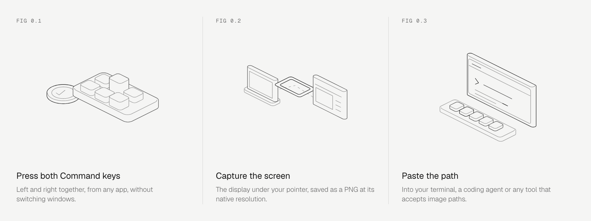

# Quickshot

### Your screen. One gesture. Ready to paste.

**A small, native screenshot utility for Mac.** Press both Command keys to capture the screen under your pointer as a full-resolution PNG and put its file path on your clipboard, ready to paste into your terminal, coding agent, or any tool that accepts images.

[Visit the website](https://hugocxl.github.io/quickshot/) · [Read the docs](https://hugocxl.github.io/quickshot/docs.html) · [Download for macOS](https://github.com/hugocxl/quickshot/releases)

[](https://hugocxl.github.io/quickshot/)

## Highlights

- **One gesture.** Left and right Command together from any app, Space, or full-screen window — without taking focus.
- **Every display.** Captures the display under your pointer at native resolution, with a quick floating preview.
- **Private & local.** Save to Desktop or auto-expiring 24-hour temporary storage; no account and no uploads.
- **Quietly native.** Swift and AppKit for macOS 14+ (Apple silicon & Intel), respecting Reduce Motion and mute.

## Development

Requires macOS 14+ and Xcode 27.

```sh
scripts/build.sh                  # Debug build into checkout-isolated DerivedData
scripts/run.sh                    # build and launch this checkout's dev app
scripts/stop.sh                   # quit this checkout's dev app
scripts/validate.sh               # build (warnings as errors), tests, app bundle
```

Website (self-contained in `website/`):

```sh
cd website && npm ci && npm run build:site && npm run check:site
```

Linked Git worktrees automatically get an isolated bundle ID (`com.quickshot.app-dev.<hash>`) and DerivedData so parallel worktrees never collide.

## Releases

Commits follow `<Added|Changed|Removed|Improved|Fixed>: <One user-facing sentence.>` — `.githooks/` automatically updates `CHANGELOG.md` and creates the matching `vX.Y.Z` tag. Pushing to `main` validates, signs, notarizes, and publishes a universal ZIP and `.sha256` checksum to GitHub Releases.

One-time secret setup:

```sh
scripts/setup-release-secrets.sh /path/DeveloperID.p12 --api-key /path/AuthKey_KEYID.p8 <issuer-id>
```

## License

Quickshot's code and original icon are [MIT licensed](LICENSE). Bundled WhiteSur artwork keeps its original [credits and GPLv3 license](Quickshot/IconCredits.txt). Made by [Hugo](https://github.com/hugocxl).
