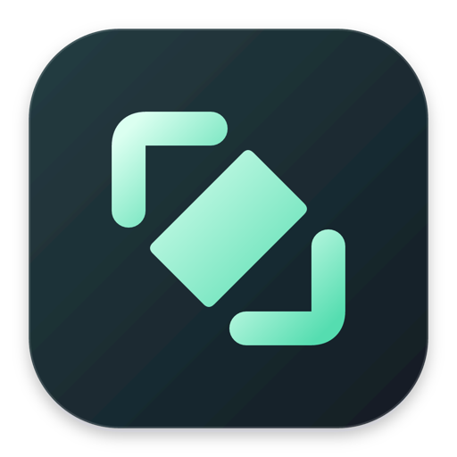

<p align="center">
  
</p>

<h1 align="center">Quickshot</h1>
<p align="center"><strong>Your screen. One gesture. Ready to paste.</strong></p>
<p align="center">A small, native screenshot utility for Mac.<br>Press both Command keys to capture your screen and copy the file path.</p>
<p align="center"><a href="https://github.com/hugocxl/quickshot/releases">Downloads</a> · <a href="#get-started">Get started</a> · <a href="CHANGELOG.md">What’s new</a></p>

## From screen to context

Show a coding agent what you see. Share a UI bug with a terminal tool. Save a
reference without breaking your flow. Quickshot captures the display under your
pointer, saves a full-resolution PNG, and puts its absolute file path on your
clipboard, ready to paste into tools that accept image paths.

**Left ⌘ + Right ⌘ → capture → paste.**

- **Stay in flow.** Capture from the menu bar or with both Command keys, without
  switching apps. A floating preview confirms the shot without taking focus.
- **Pick the screen with your pointer.** Move to the display you want to capture;
  Quickshot saves the whole display at its native resolution.
- **Keep it or let it go.** Save to Desktop for keeps, or choose temporary storage
  with automatic cleanup after 24 hours.
- **Open it in a click.** Click the preview to open the PNG, or find your captures
  from the menu.
- **Made for macOS.** A native Swift and AppKit app for Apple silicon and Intel,
  with no Dock icon, account, or third-party runtime dependencies.

## Get started

Requires **macOS 14 Sonoma or later**.

Release downloads will appear on the [Releases page](https://github.com/hugocxl/quickshot/releases)
once the first signed release is published. To build today, see [Development](#development).

1. Download the universal ZIP from Releases, unzip it, and move **Quickshot.app**
   to **Applications**.
2. Open Quickshot. In **Permissions & Setup…**, allow **Input Monitoring** for the
   global shortcut and **Screen Recording** for screenshots. Relaunch if macOS asks.
3. Move your pointer to the display you want, then press **left Command and right
   Command together**. Release both before your next shot.
4. Paste the copied path into your terminal, coding agent, or another tool that
   accepts local image paths.

The clipboard contains the **PNG’s path**, not the image itself. Quickshot captures
an entire display; it does not offer region selection or annotation.

## Your captures, your choice

Choose **Save Files To** in the menu. **Desktop** keeps captures until you delete
them. **tmp** stores them in Quickshot’s temporary folder and removes captures older
than 24 hours at launch and hourly while running; macOS can also clear temporary
files. Changing the destination leaves existing captures where they are.

Screenshots stay on your Mac. Quickshot has no upload service. Input Monitoring
lets it recognize the two Command keys; it does not record your typing.

The preview respects Reduce Motion, and the shutter sound respects muted audio.
Hover to keep the preview visible, click to open the file, or dismiss it with **×**.

## Need a hand?

Open **Permissions & Setup…** from the menu to check access. If the shortcut stops
responding, try **Retry Shortcut**. Secure Keyboard Entry and protected password
fields can temporarily prevent macOS from delivering global shortcuts.

Use **Take Screenshot** to check capture independently of the keyboard shortcut.
For a bug report, **Copy Permission Diagnostics** provides useful troubleshooting
information; review it before sharing in a [GitHub issue](https://github.com/hugocxl/quickshot/issues).

## Development

Open `Quickshot.xcodeproj` in Xcode with Swift 6 support and select your development
team under Signing & Capabilities, or run:

```sh
scripts/build.sh       # signed local Debug build
scripts/validate.sh    # isolated build, regression tests, and bundle checks
```

See [development notes](docs/DEVELOPMENT.md) for architecture and manual checks,
and [RELEASE.md](RELEASE.md) for signing and automatic GitHub publication.

## License

Quickshot’s code and original icon are [MIT licensed](LICENSE). The previously
used WhiteSur artwork remains bundled with its original [credits and GPLv3 license](Quickshot/IconCredits.txt).
